# WASI Benchmarks

Seven WebAssembly runtimes, measured 2026-11-12 (UTC) on an Apple M5 MacBook
Air and an Intel Core i9-14900K: Silverfir-nano 0.7.0's JIT and interpreter,
Wasmtime Cranelift 50.0.1, V8 TurboFan (Node.js 26.13.1), Wasmtime Winch
50.0.1, wasm3 0.9.0, and wasmi 2.0.0.

Every metric is a **rate — higher is better**. The benchmarks self-time to a
wall-clock target (2 s by default) and report work per second, so a regression
suite costs about the same on any engine and the numbers stay comparable across
a 20× spread in speed. The harness invokes CoreMark's explicit non-standard
regression mode for this bounded run, in every cell. CoreMark's source and bare
command line remain compatible with upstream EEMBC CoreMark: without the
option, its own calibration runs the measured interval for at least 10 seconds
and emits the official result format.

Each cell is the mean of interleaved rounds: two on the M5, with 75 s of
cooling after each engine's sweep because that machine has no fan, and three on
the 14900K, pinned to one performance core with ASLR off.

The compiled and interpreted engines get **separate charts**: a compiler is ~6×
an interpreter here, so putting both on one scale would crush the interpreter
bars into slivers and hide the comparison that matters for each class. Winch is
wasmtime's baseline (single-pass) compiler, so it rides the compiled chart but
lands about halfway to the interpreters — that gap *is* the optimizing tier.

**[Full tables, method, and caveats → RESULTS.md](RESULTS.md)**

## Apple M5

### Integer / Control Flow

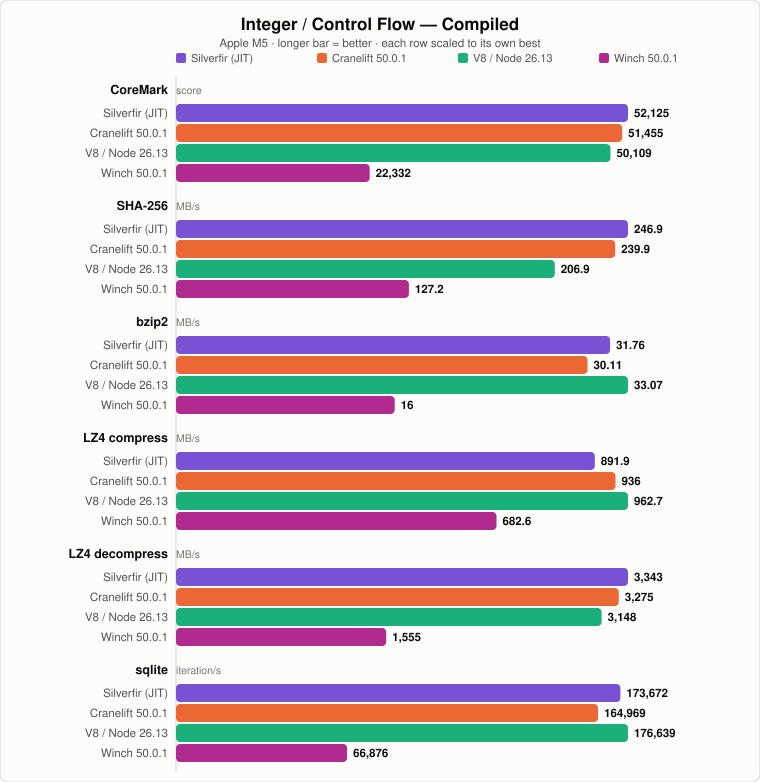

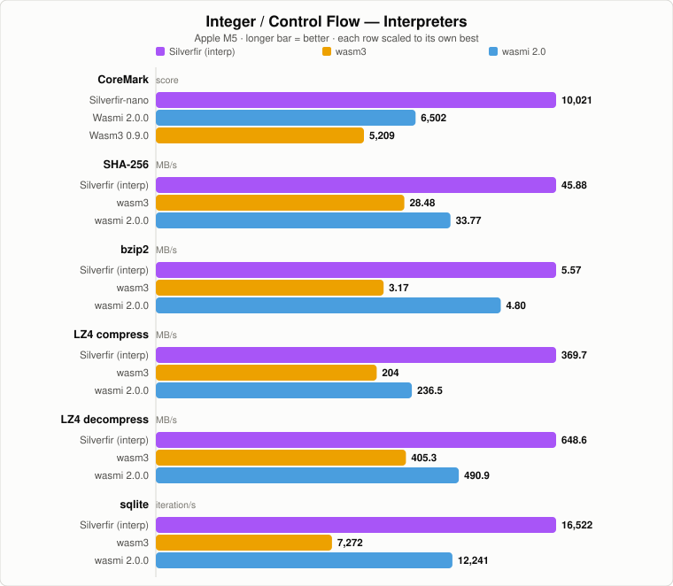

### Lua Interpreter

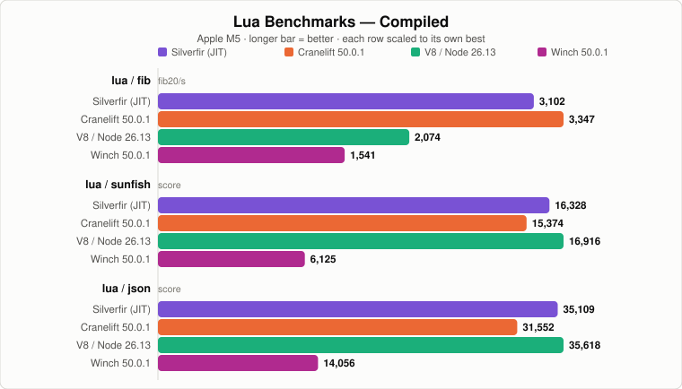

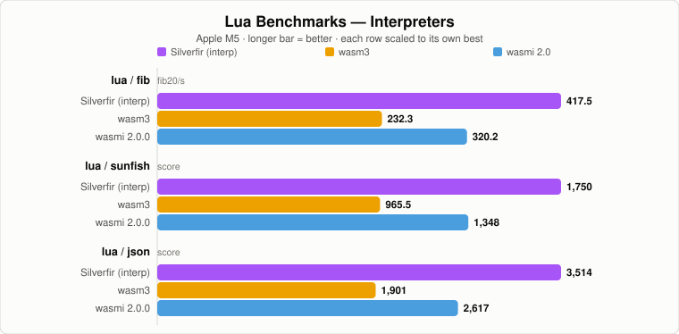

### Floating Point

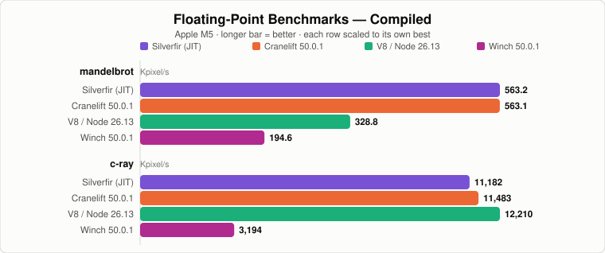

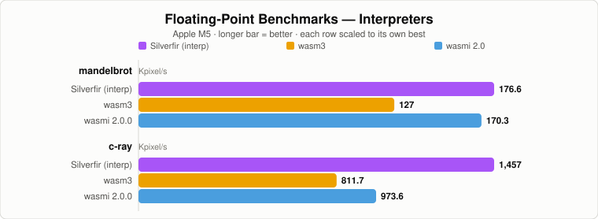

### Memory Bound (STREAM)

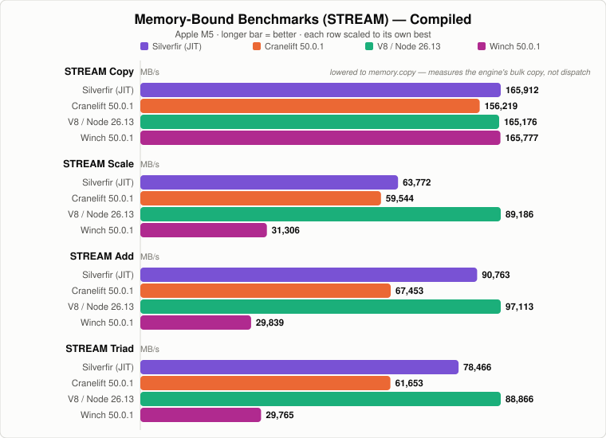

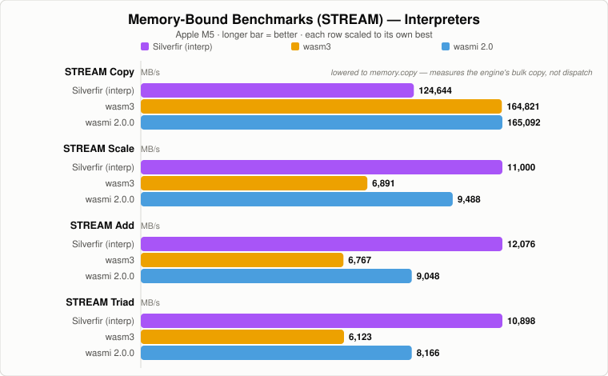

### Call Overhead

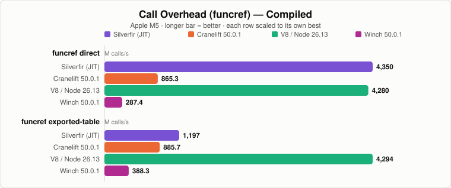

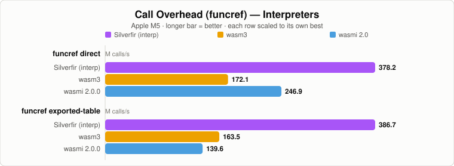

STREAM Copy is the one row that does not measure the engine's generated code:
the current clang lowers the copy loop to a bulk `memory.copy`, so every
runtime ends up in its bulk-copy path. It is kept because it is a fair
comparison of that path, and on the M5 it shows the Silverfir interpreter's
copy handler a quarter behind the other engines — see the footnote in
[RESULTS.md](RESULTS.md#apple-m5).

The funcref rows are call micro-benchmarks: a direct call through a function
reference, and the same call through an exported table.

## Intel Core i9-14900K

### Integer / Control Flow

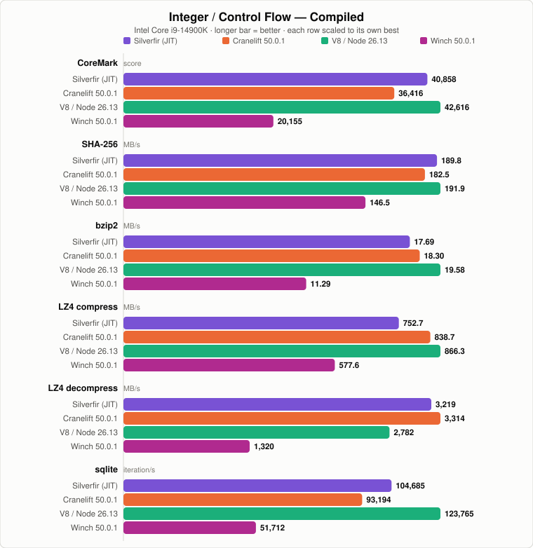

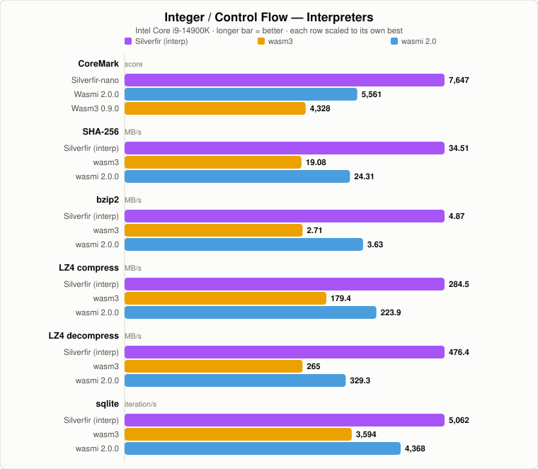

### Lua Interpreter

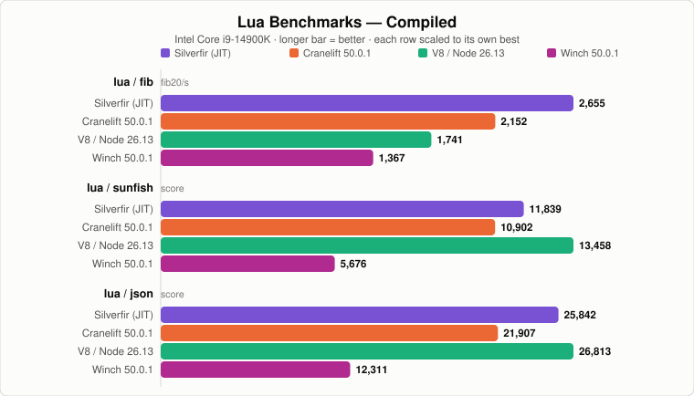

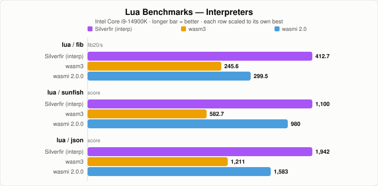

### Floating Point

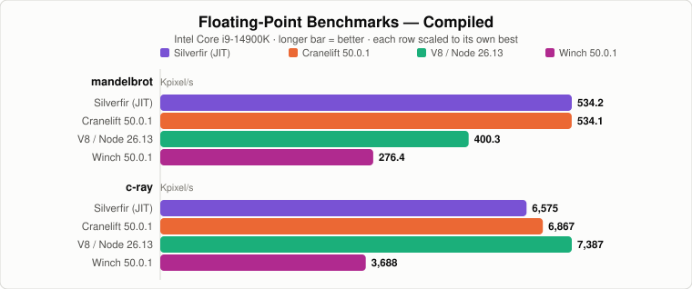

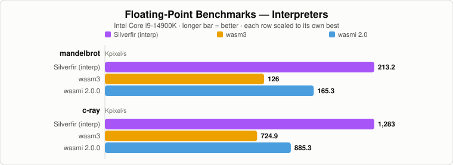

### Memory Bound (STREAM)

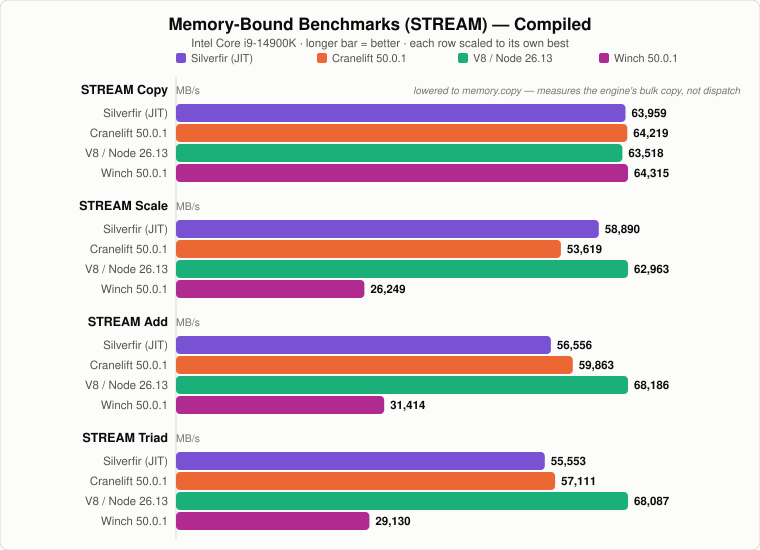

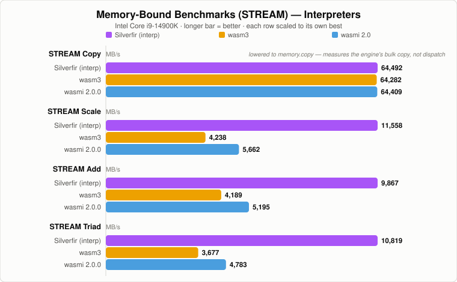

### Call Overhead

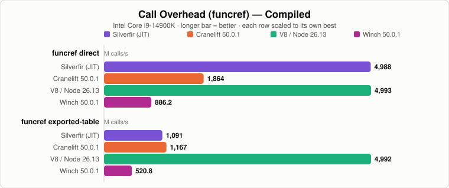

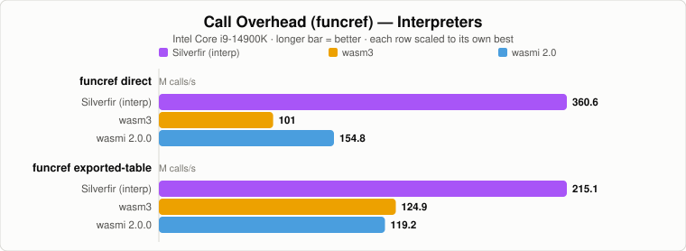

## Where Silverfir stands

Against the other **optimizing compilers** the JIT is level on this suite. It
is a little ahead of Cranelift 50: a geomean 1.06× on the M5 and 1.04× on the
14900K over the 14 application metrics, ahead on 14 and 9 of all 17. It is
level with V8 14.6, at 1.03× and 0.98×, and V8 takes the most rows on both
machines: best-of-four over the 17 metrics is V8 10, Silverfir 6, Cranelift 1
on the M5 and V8 13, Silverfir 2, Cranelift 1, Winch 1 on the 14900K. CoreMark
reads Silverfir 52,125, Cranelift 51,455, V8 50,109 on the M5 and V8 42,616,
Silverfir 40,858, Cranelift 36,416 on the 14900K. It beats V8 clearly on
mandelbrot (1.71×, 1.33×) and Lua fib (1.5×), and trails it clearly on the
exported-table call (V8 is 3.6× and 4.6× ahead) and the STREAM arithmetic
kernels.

On the wasmi-benchmarks corpus the same release leads both compilers on three
platforms; [those standings](../wasmi_benchmarks/README.md) are the other half
of the picture.

**Winch** takes no row but the `memcpy` tie, as expected of a baseline
compiler: a median 0.40× of Silverfir's JIT on the M5 and 0.51× on the 14900K,
and a median 2.5× and 2.7× of Silverfir's interpreter.

Its **interpreter** is the fastest on every dispatch-sensitive benchmark on
both machines: 16 of 17 metrics on the M5, where it loses only the
`memory.copy` row, and all 17 on the 14900K. Against wasmi 2.0, the closer
rival on nearly every row, the margin is 1.04–2.77× on the M5 (median 1.34×)
and 1.12–2.33× on the 14900K (median 1.40×); against wasm3 the medians are
1.80× and 1.78×. CoreMark reads 1.54× wasmi and 1.92× wasm3 on the M5.

## Running them

```sh
python3 run_tests.py                 # JIT; 2s self-calibrated tests
python3 run_tests.py --interp        # this repo, interpreter
python3 run_tests.py --time 10       # 10s per benchmark
python3 run_tests.py --exec "<path>/wasmtime run" --cli-args "--dir ."
python3 run_tests.py --exec "<path>/wasmtime run" --cli-args "-C compiler=winch --dir ."
python3 run_tests.py --exec "<path>/wasm3"
python3 run_tests.py --exec "$HOME/.cargo/bin/wasmi" --cli-args "--dir . --"   # 2.0: binary is `wasmi`
node run_v8.mjs --time 2             # V8 via Node's WASI
make                                 # rebuild every .wasm from source
python3 gen_svg.py                   # redraw the charts from RESULTS.md
```

`run_tests.py` passes `--target-seconds=<seconds>` to CoreMark. This keeps CI
and local regression runs bounded, separates calibration from the reported
sample, and labels the result as non-standard. Invoke `coremark.wasm` without
that option when producing an official CoreMark result; the default upstream
10-second-minimum behavior is unchanged.

`gen_svg.py` reads its numbers out of the RESULTS.md tables, so the charts and
the tables cannot disagree — update the table, re-run it, done. Every chart it
draws is written to [`assets/`](../../assets) at the repo root, the one place
this project keeps rendered images; the pages here and the top-level README
both link into it.

Twenty-one files come out of a run: the twenty above, five charts for each
machine with each split by engine class, plus
[`assets/coremark.svg`](../../assets/coremark.svg), the summary the top-level
README leads with. A table names its machine with `machine="..."` in its
chart marker, and the charts take their subtitle from it. That one compares the three interpreters on a single shared
scale and orders them fastest-first. The CoreMark row in the larger
interpreter chart uses the same ordering; its other rows retain their stable
runtime order.
